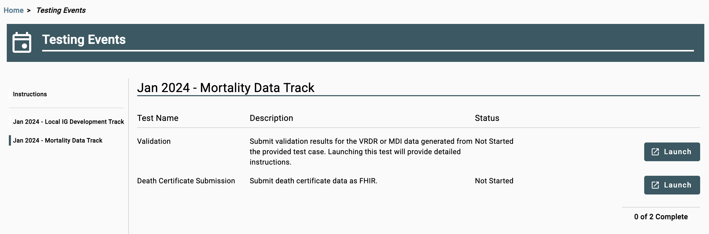
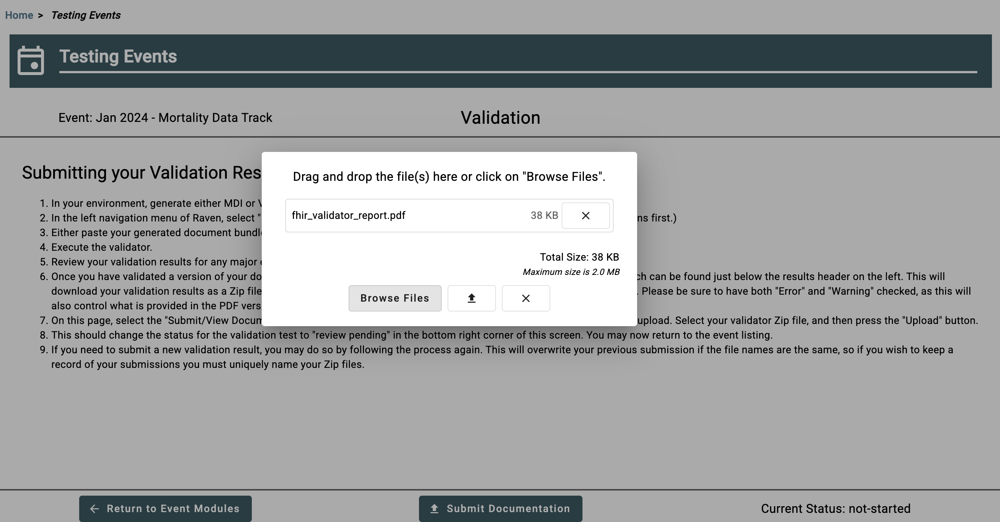
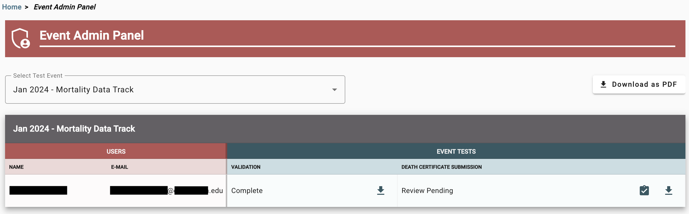

.. _event-management:

Testing Event Management
========================
The Event Management feature of Raven provides functions to support testing events, including HL7 Connectathons.

.. note::
    Event Management is not supported in the Community Edition of Raven. For more information, please see :doc:`Raven Versions and Editions <versionsEditions>`.

How Events Work
---------------
Events are a collection of test scenarios, which may consist of either workflow simulator modules or file uploads. Each event tracks users success as completing a workflow or uploading the requested files. Files are typically validation records, screenshots, or other documents that prove success for a given task. 

For example, an event around testing a Toxicology workflow might consist of the Workflow Simulator Onboarding module as a first scenario to show basic connectivity to a server, with Raven acting as a client. In other words, a CMS Vendor would test their toxicology record ingestion with Raven in the place of a LIMS. It may then move onto the Toxicology Submission workflow module as the next test scenario, showing that the vendor can fully receive the toxicology records in the MDI FHIR IG data structures.

Setting Up New Events
---------------------

Events are specially managed on the Raven MDI FHIR Server as FHIR Questionnaire resources.

<!-- TODO: Complete write up on the event models -->

Registering for Events
----------------------

.. image:: ../images/event-manager/event-manager_2026_1.png
   :alt: Raven Event Manager - Event Registration.

Administering Events
--------------------
For administrative users, they have access to a special panel that allows a review of all users' event status as well as links to download file submissions. Administrators may manually modify the status of a test scenario as needed, such as to mark a test complete after file review or reset a status as needed.

Administrative users may also export a PDF summarizing the event success or failure for attestation purposes.

