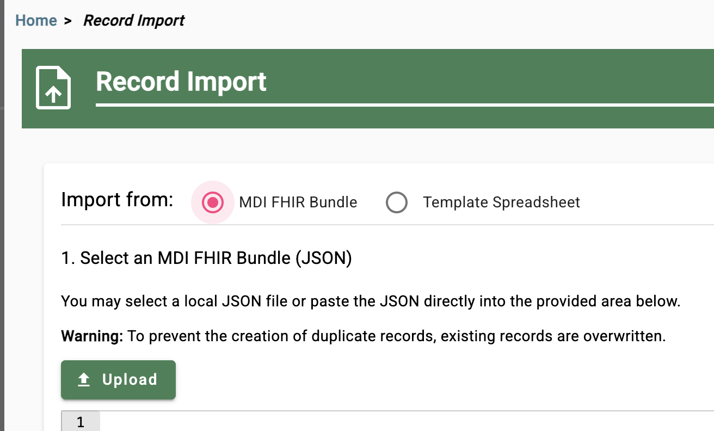
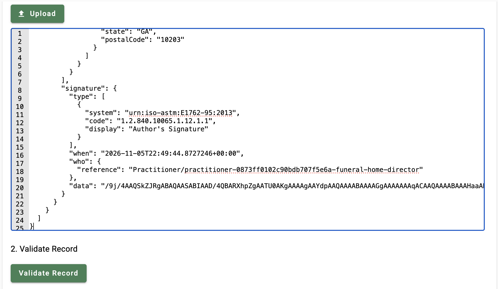
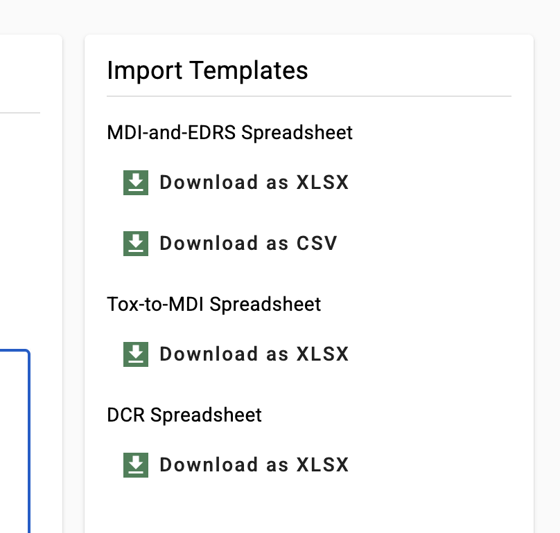
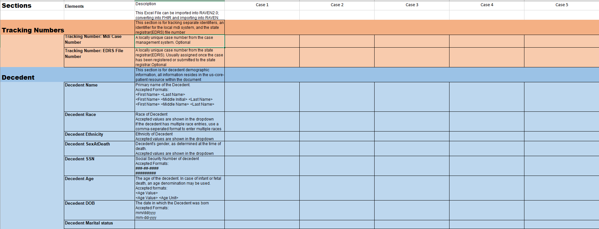
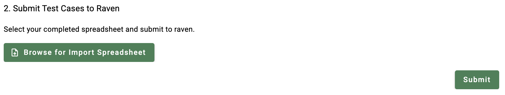
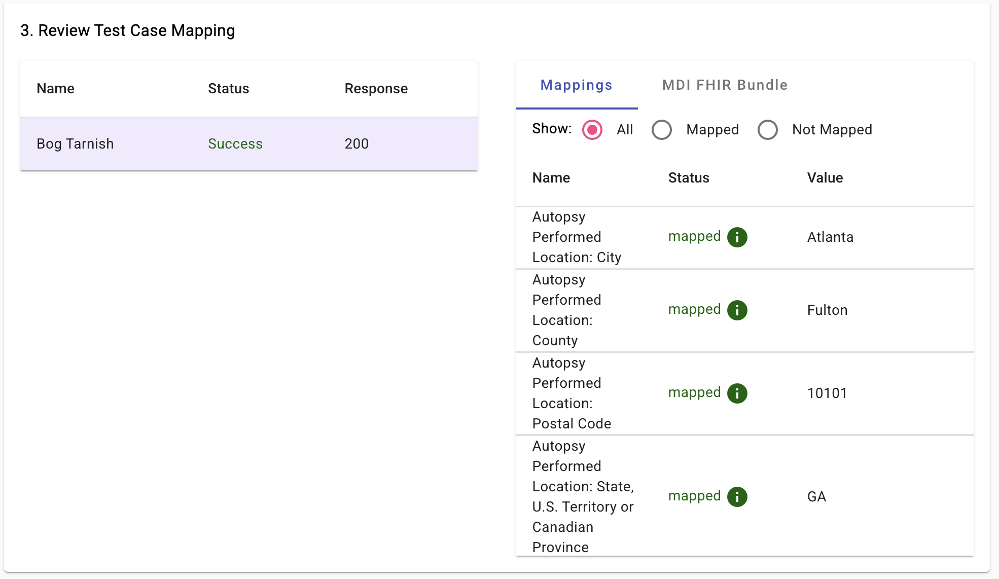

.. _record-management:

Record Management
=================

Record Import
-------------
Record Importing is a Raven feature that allows for importing several data formats into the Raven FHIR Server.

* FHIR Bundles (Note: Must be validated.)
* XLSX Spreadsheets (.xlsx)
* Comma-separated Values (.csv)

XLSX and CSV Templates
^^^^^^^^^^^^^^^^^^^^^^
Due to the complexity of MDI FHIR Records, import templates are provided in XLSX and CSV formats for each MDI FHIR IG use case: MDI-and-EDRS data exchange, Toxicology-to-MDI reports, and Death Certificate Review. These templates provide a stepping stone for testing when transitioning from non-FHIR compliant systems to FHIR and/or the MDI FHIR IG.

This allows users to leverage their own data with other features of the application such as the Record Viewer or Workflow Simulator, even prior to implementation of FHIR and the MDI FHIR IG in their own systems. The generated MDI FHIR IG records may also be used for reference examples of data known to users.

JSON MDI FHIR Bundles
^^^^^^^^^^^^^^^^^^^^^
Users may also import previously generated FHIR JSON Bundles through the Record Import feature. For users who have already begun implementation in their own systems, this may be used to leverage their data in other featuers of the application.

For HL7 Connectathon or other testing event support, test case data may be provided with the intent of having participants to generate a curated record that after being loaded through the Record Import feature may be used in the Record Comparison tool against a known valid example of the same record. For more information, please see ":ref:`validation-comparison`".

Instructions
^^^^^^^^^^^^

Start by selecting "Import" on the left nav menu. When on the Record Import screen, select import type as shown below.

JSON Import
+++++++++++
For the JSON import option, you must provide an MDI FHIR IG Document or Message Bundle for one of the supported MDI FHIR IG use cases/workflows. You may select a local file to load (with an extension of .json) or paste your JSON directly in to the provided input area. User provided JSON must complete validation before it will be loaded into the Raven FHIR Server. Once you have provided your FHIR Bundle, you may select "Validate Record" to start the validation process.

Once the validation is complete, the results will be provided below the JSON input area. If there are errors, you must resolve them before submission is enabled. Note that warnings or other levels of validation reported do not block submission.

Template (XLSX/CSV) Import
++++++++++++++++++++++++++
When importing via spreadsheet template, users should first download the provided sheets in their preferred format. The download list can be found in the right side column of the Recort Import feature as shown below.

For users who cannot generate FHIR JSON for testing, or are unfamiliar with the FHIR standard in general, these templates provide an easy method of converting records to FHIR for use within Raven and as an educational reference. Users can fill in individual case data as plaintext values, and using the importer generate the appropriate MDI FHIR IG record.

An example of the spreadsheet is shown below. You can view the import template schemas in full at :doc:`Raven Import XLSX/CSV Spreadsheet Definitions <template-schemas>`.

.. toctree::
   :maxdepth: 1
   :hidden:

   template-schemas

Multiple records may be imported at once. For the XLSX versions of the import template, a single decedent record or toxicology report is a column. In the CSV version, a single record is a row.

Once you have completed filling out your template, select the "Browse for Import Spreadsheet" button to open the file select dialogue, and select your file. Then hit the submit button.

Once your file is submitted successfully, a report is displayed documenting what values were mapped to which fields. One record is displayed at a time, and records may be selected in the left column by decdent name. Users may also select to view the generated FHIR Bundle by selecting "MDI FHIR Bundle" in the right hand mapping column.

Record Viewer
-------------
The Record Viewer is a UI component which allows the browsing and viewing of Raven FHIR Server records, 
encompassing both MDI Case Documents (MDI to EDRS) and Toxicology Reports (LIMS to MDI). 
In addition to providing a user-friendly option for viewing the data present on the FHIR Server, 
the layout is structured from the perspective of the MDI Implementation Guide to serve as an educational 
tool to better understand the data structure and fields which make up the MDI to EDRS and Toxicology to 
MDI documents. 

.. image:: ../images/case_viewer.png
   :alt: Raven Record Viewer Diagram
  
The Record Viewer also features a FHIR Resource Explorer, which allows users to select a field and 
see the underlying FHIR Resource structure containing the related data. The FHIR Resource Explorer will 
support JSON and XML formats, as well as a human readable “narrative view”. 

.. note::
    **Use Case**: Human readable display of MDI FHIR IG data with a FHIR explorer. Any cases loaded in 
    the Raven FHIR server should be retrievable by Record Viewer. Users can use FHIR APIs to load the data.
