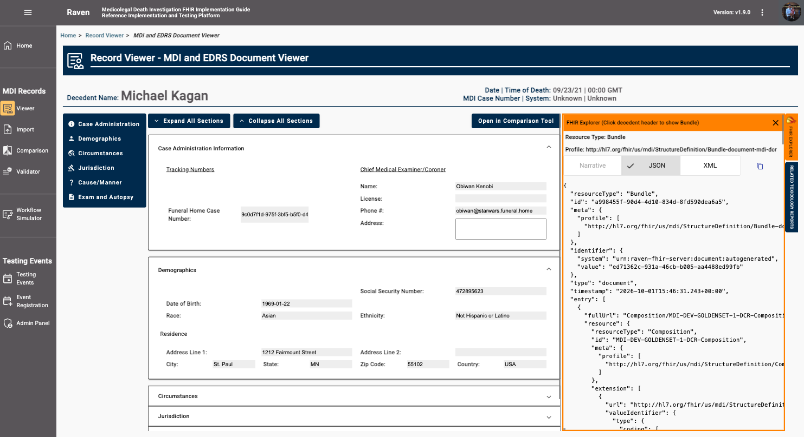

.. _record-management:

Record Management
=================

Record Import
-------------
Record Importing is a Raven feature that allows for importing several data formats into the Raven FHIR Server.

* FHIR Bundles (Note: Must be validated.)
* XLSX Spreadsheets (.xlsx)
* Comma-separated Values (.csv)

XLSX and CSV Templates
^^^^^^^^^^^^^^^^^^^^^^
Templates are provided for XLSX/CSV import for each MDI FHIR IG use case: MDI-and-EDRS data exchange, Toxicology-to-MDI reports, and Death Certificate Review. Due to the complexity of MDI FHIR Records, the templates provide a stepping stone for testing when transitioning from non-FHIR compliant systems to FHIR and the MDI FHIR IG. The importer maps the MDI templates to the appropriate MDI FHIR profiles and uploads them to the MDI FHIR server. 

For users who are implementing MDI FHIR IG support, the Record Import feature allows generation of MDI FHIR IG compliant data from user provided cases to provide a FHIR JSON example to use as an implementation reference. It also allows users to use their own data with other features of the application such as the Record Viewer or Workflow Simulator, even prior to implementation of FHIR and the MDI FHIR IG in their own systems.

JSON FHIR Bundle Import
^^^^^^^^^^^^^^^^^^^^^^^
Users may also import previously generated FHIR JSON Bundles through the Record Import feature. For users who have already begun implementation in their own systems, this may be used to leverage their data in other featuers of the application as well.

For HL7 Connectathon or other testing event support, test case data may be provided with the intent of having participants to generate a curated record that after being loaded through the Record Import feature may be used in the Record Comparison tool against a known valid example of the same record. For more information, please see ":ref:`validation-comparison`".

How to Use the Record Import Feature
^^^^^^^^^^^^^^^^^^^^^^^^^^^^^^^^^^^^

Start by selecting "Import" on the left nav menu. When on the Record Import screen, select import type as shown below.

.. image::
   ../images/record-import/import_2026_1.png
   :alt: Raven Record Import Type Selection

JSON Import
+++++++++++
For the JSON import option, you must provide an MDI FHIR IG Document or Message Bundle for one of the supported MDI FHIR IG use cases/workflows. You may select a local file to load (with an extension of .json) or paste your JSON directly in to the provided input area. User provided JSON must complete validation before it will be loaded into the Raven FHIR Server. Once you have provided your FHIR Bundle, you may select "Validate Record" to start the validation process.

.. image::
   ../images/record-import/import_2026_2.png
   :alt: Raven Record Import JSON Input and Validation

Once the validation is complete, the results will be provided below the JSON input area. If there are errors, you must resolve them before submission is enabled. Note that warnings or other levels of validation reported do not block submission.

Template (XLSX/CSV) Import
++++++++++++++++++++++++++

Spreadsheet Schema
^^^^^^^^^^^^^^^^^^
If the user cannot construct the FHIR records necessary, or are unfamiliar with the FHIR standard in general;
Raven provides an excel spreadsheet XLSX template for easy of use. Users can fill in individual case data as
plaintext values, and use the import case view on the RAVEN platform. RAVEN will transform the XLSX data into
individual FHIR case records that adhere to the FHIR-MDI-IG standard. The template is hosted on the RAVEN
base site; and a `copy can be directly downloaded from the public internet <https://gtvault-my.sharepoint.com/:x:/g/personal/mriley7_gatech_edu/EW6MPoLovyROhAxtk4tjqkkBNzn0SstRhs_g4OOwBhcPIA?e=oL0Ci5>`_.

.. image:: 
   ../images/RavenXLSXFileHeader.png
   :alt: Use the XLSX file to construct case data and then import to transform to FHIR

**RAVEN Import XLSX Spreadsheet Definitions**

.. dropdown:: MDI-and-EDRS Document Bundle Import Template
   :open:

   .. include:: ./template-tables/mdi-and-edrs-template.rst

Record Viewer (Viewing Cases)
-----------------------------
The Record Viewer is a UI component which allows the browsing and viewing of Raven FHIR Server records, 
encompassing both MDI Case Documents (MDI to EDRS) and Toxicology Reports (LIMS to MDI). 
In addition to providing a user-friendly option for viewing the data present on the FHIR Server, 
the layout is structured from the perspective of the MDI Implementation Guide to serve as an educational 
tool to better understand the data structure and fields which make up the MDI to EDRS and Toxicology to 
MDI documents. 

  
The Record Viewer also features a FHIR Resource Explorer, which allows users to select a field and 
see the underlying FHIR Resource structure containing the related data. The FHIR Resource Explorer will 
support JSON and XML formats, as well as a human readable “narrative view”. 

.. note::
    **Use Case**: Human readable display of MDI FHIR IG data with a FHIR explorer. Any cases loaded in 
    the Raven FHIR server should be retrievable by Record Viewer. Users can use FHIR APIs to load the data.
