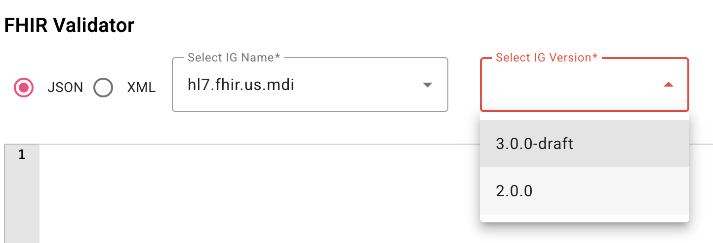
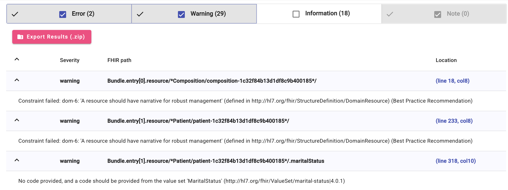
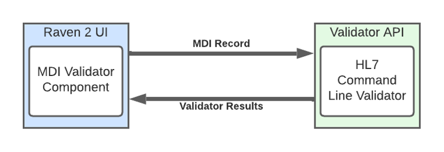

.. _validation-comparison:

Validation And Comparison
=========================
For testing support, Raven provides Validation and Document Comparison features.

MDI FHIR Validation
-------------------
The Raven MDI FHIR Validator feature provides the official FHIR Validation engine loaded to support both fully published and continuous integration build versions of the MDI FHIR IG and related FHIR IGs, including proof of concept/prototype IGs such as the Violent Death and Overdose Reporting (VDOR) IG.

The MDI FHIR Validator is provided as standalone feature available in the left navigation menu, as well as embedded into other features such as the JSON Record Importer and Testing Event Management.

The MDI FHIR Validator allows the user to submit a JSON or XML FHIR Resource (either Bundles or individual resources) and validate against a specific IG version. While the official FHIR Validator interface supports doing this as well, it can be cumbersome

Selecting the "Upload" button opens the file select interface and allows users to select a local JSON or XML file to load. Users may also paste their FHIR Resource into the text area directly.

Selecting "Format Input" will format the provided JSON or XML to be more legible if needed (also known as "pretty print").

When ready, selecting "Submit" will send the FHIR Resource provided to the MDI FHIR Validator backend, and return results.

Users may toggle the type of results reported. Errors should be resolved at all times unless impossible (such as an underlying IG bug), while warnings should be reviewed. Warnings might sometimes represent a validation issue that cannot be handled entirely automatically by the validator.

The validation results can be exported as a PDF report by clicking the "Export Results" button. The ZIP provided contains the submitted resource, the validation report, and a README file with more information on reading the report.

For some Testng Events, the valdiation report may be submitted as evidence of successful FHIR data testing.

Validator Archtecture
^^^^^^^^^^^^^^^^^^^^^
The Raven Validator API wraps the official HL7 Validator JAR file. The API Service handles pre-loading the MDI FHIR IG and other packages, as well as provides. The full API specification can be seen at the `Raven Demo Validator Swagger Docs <https://heat.icl.gtri.org/fhir-validator-service/fhir/docs>`_.

Record Comparison
-----------------
The Record Comparison Tool is a feature to compare user generated test records with pre-validated MDI FHIR IG MDI-and-EDRS Document Bundle provided in the Raven FHIR Server.

Users participating in Test Events may be provided with a set of test cases for which they can attempt to generate MDI FHIR IG MDI-and-EDRS Bundles, and then use the comparison tool to be provided a side by side comparison of the known-valid versions.

<!-- SCREENSHOT HERE -->

By reviewing the user generated and known valid cases this way, implementors can quickly spot issues in FHIR Resource structures or value assignment and ensure their FHIR data contents are correctly populated.

