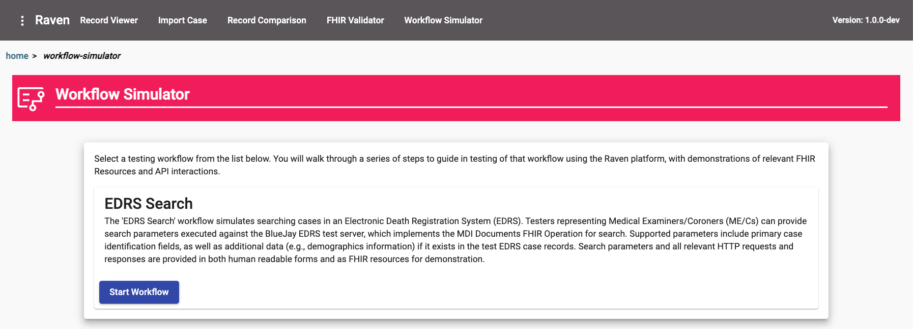
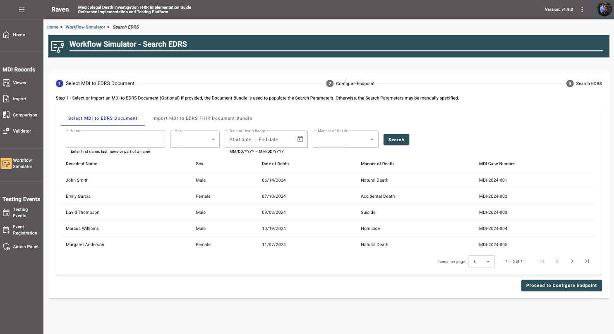
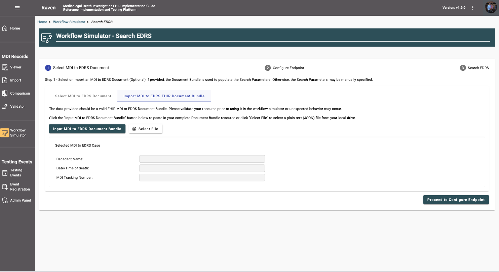
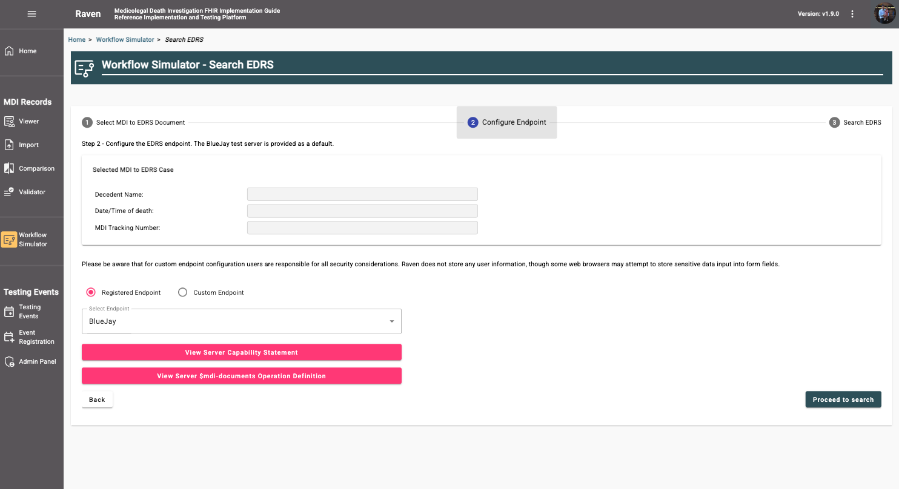
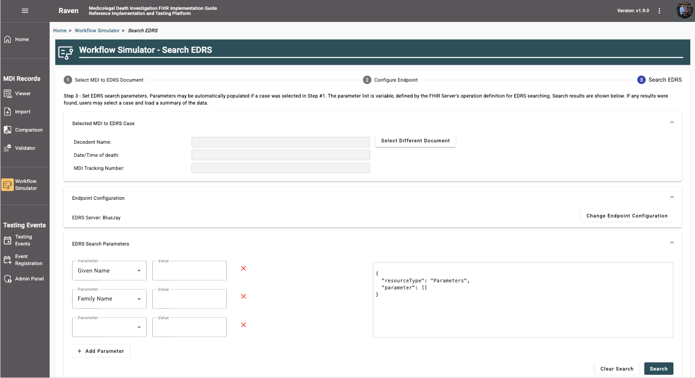
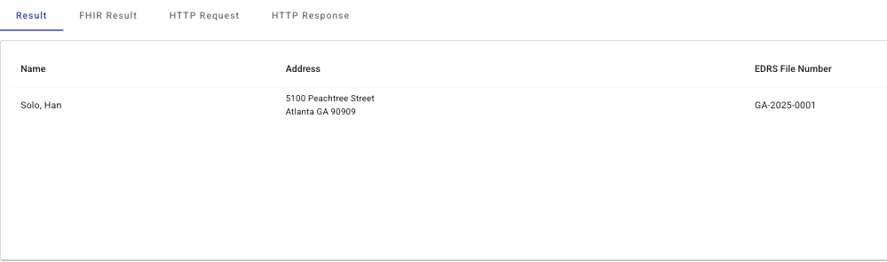

.. _workflow-simulator:

Workflow Simulator
==================
The Workflow Simulator is a feature of the Raven platform that allows users to simulate data exchange workflows between Medicolegal Death Investigation (MDI)
systems, including:
* Coroner/Medical Examiner Case Management Systems (CMS)
* Electronic Death Registration Systems (EDRS)
* Toxicology Laboratory Information Systems (LIMS)

The supported workflows are defined by major interoperability use cases, such as a CMS searching an EDRS. Each workflow is a self contained module, with the modules divided into two major categories.

1. Testing Modules: These modules are developed for testing events to evaluate the interoperability implementation of MDI systems.
2. Operational Modules: These modules demonstrate workflows that are defined by users in the MDI community to standardize the operations such as search, update, certification, amendment, or messaging.  

Note that some testing requirements are supported by other Raven features such as the FHIR Validator and Record Comparison tools. Operational modules are often more complex, such as the Search EDRS API workflow. These modules are implemented as a proof-of-concept or reference of the workflow and may be used for data exchange simulation prior to production development. Users can use the Workflow Simulator Operational Modules as guidance and as a metrics to help decision making s as they modernize their systems.

Workflows/Use Cases
-------------------
When opening the Workflow Simulator module, the user will be given a list of currently implemented workflows
to select from. Once selected, the workflow will be loaded, presented as a step by step process in Raven.

Onboarding
~~~~~~~~~~
This is a special workflow designed for testing events, allowing Raven to act as a client to a user's server to perform connecton testing, or to provide an example of connecting to a third party server as needed. It is used in testing events as a first step to illustrate basic connectivity.

Search EDRS (CMS to EDRS)
~~~~~~~~~~~~~~~~~~~~~~~~~
The Search EDRS workflow simulates connecting to an EDRS server from a C/ME CMS client. It demonstrates server connection and the Search EDRS API, including how FHIR Parameter resources are formed based on a given record. The demonstration can be performed with any record on the Raven MDI FHIR Server or the values can be entered manually on the final step. The Bluejay MDI FHIR Server packaged with the Raven Platform acts as the default EDRS server, though custom servers may be used as well.

Step 1 - Import/Select Record (Optional)
^^^^^^^^^^^^^^^^^^^^^^^^^^^^^^^^^^^^^^^^
The first step of the Search EDRS workflow allows the user to select an MDI to EDRS Document from the Raven FHIR Server to use to auto
populate search parameters with the values from the record. Users may also import a record into the workflow as an MDI to EDRS Document
Bundle in the FHIR JSON format. This step is entirely optional, and if a user wishes to proceed without a case select they can
manually input all search parameters required.

Step 2 - Configure Endpoint
^^^^^^^^^^^^^^^^^^^^^^^^^^^
After the user decides on whether they would like to use an existing record, they are taken to the Configure Endpoint step. This part of
workflow is the configuration of the FHIR endpoint for testing the search functionality against an Electronic Death Registration System (EDRS).
Users may select between a pre-registered Endpoint or a Custom Endpoint. Pre-registered endpoints are configured in Raven and will typically
provide open testing endpoints, including the Raven BlueJay server which acts as a test EDRS. Selecting a pre-registered endpoint requires no
additional configuration from the user. For custom endpoints, users may provide a non-registered testing endpoint and setup basic authorization
as needed. Custom endpoints are not recorded in any form by the Raven platform, and their use is entirely the responsibility of the user.
Please note that the Raven platform is a single page application based in a web browser, and using custom endpoints may result in the user's
browser recording sensitive information separate from the Raven platform. (This should be managed by the user in coordination with their
organization's internal IT policies.)

Step 3 - Search EDRS (API Interaction)
^^^^^^^^^^^^^^^^^^^^^^^^^^^^^^^^^^^^^^
The final step of the Search EDRS workflow is the execution of search parameters against the identified EDRS endpoint. The potential parameters
fields are data driven and populated automatically based on the FHIR MDI Implementation Guide "MDI Documents" Operation Definition. Users may
select any number of parameter fields they wish to use. If a record was selected or imported during step 1, the parameters will attempt to have
their values automatically populated. As the user enters data or modifies the parameter fields, an example of the FHIR Parameters resource is
shown for demonstration purposes which matches the current state of the parameters HTML form. This allows users building reference
implementations a model to which they can refer in their own development, tying a standard HTML style form to the underlying FHIR resource it
will produce. Once satisified with their search parameters, users may connect to the EDRS and attempt to find matching records.

If records are identified on the EDRS, the results are shown below the parameters. The results can be viewed either as a human readable table
summarizing the matching records, or as a raw FHIR search set bundle. In addition, users can use the HTTP Request and Response tabs to better
be able to identify the headers involved in the HTTP call to the EDRS. In the summary table under the default Results tab, a record may be
selected to load further information.

Once selected in the Results table, the record is displayed below the table. As with the full search results, this can be viewed either as a
human readable summary and as the underyling FHIR MDI to EDRS Document Bundle

Search EDRS - BlueJay with OAuth 2.0
~~~~~~~~~~~~~~~~~~~~~~~~~~~~~~~~~~~~
This workflow is an alternative version of the Search EDRS workflow that uses the BlueJay MDI FHIR Server to demonstrate Oauth 2.0 authentication.

The BlueJay server is registered with sample credentials for Oauth 2.0. Users are walked through using these credentials to request an authorization token, then use that token to perform Search EDRS operations.

Cremation Clearance Request Submission
~~~~~~~~~~~~~~~~~~~~~~~~~~~~~~~~~~~~~~
The Cremation Clearance Request Submission (CCRS) module allows Raven to be used a client in a Cremation Clearance Request Submission workflow. Users are able to directly input decedent information into a form containing fields from the MDI FHIR IG DCR Profiles to generate a DCR Message Bundle. Users may then enter endpoint details and submit that Bundle to a server's CCRS endpoint.

Toxicology Record Submission
~~~~~~~~~~~~~~~~~~~~~~~~~~~~
The Toxicology Record Submission workflow simulation demonstrates the transfer of a toxicology report from a Laboratory Information Management System (LIMS) to a Coroner & Medical Examiner's Case Management System (CMS). In this simulation, the user provides the CMS toxicology receiving API endpoint URL, user credentials, and any required headers. 
